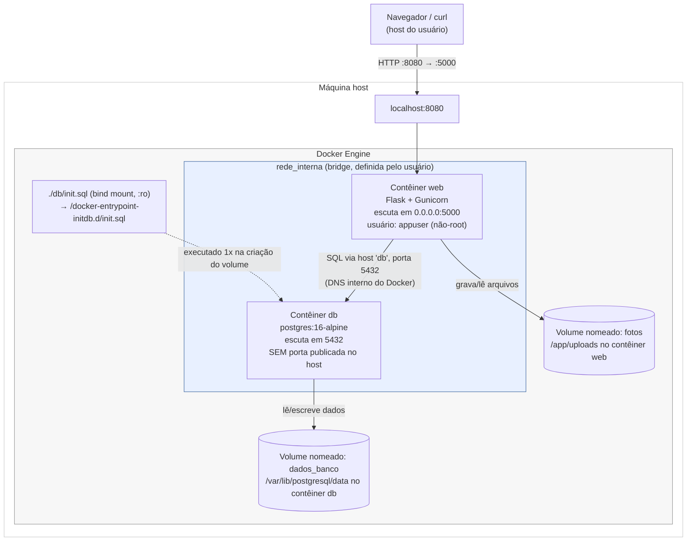

# A2 — Diagrama de arquitetura

## Visão geral

## Dentro x fora da rede interna

| Elemento | Posição |
|---|---|
| Navegador / `curl` do usuário | **Fora** de qualquer rede Docker — acessa só a porta publicada `8080` no host. |
| Contêiner `web` | **Dentro** de `rede_interna`; é o único ponto de entrada (porta `8080:5000` publicada). |
| Contêiner `db` | **Dentro** de `rede_interna`; nenhuma porta publicada no host — só é alcançável por quem está na mesma rede Docker (ou seja, só o `web`). |
| Volume `dados_banco` | Não pertence à rede; é um recurso de armazenamento do Docker, montado diretamente no contêiner `db` em `/var/lib/postgresql/data`. |
| Volume `fotos` | Mesma lógica, montado no contêiner `web` em `/app/uploads`. |
| `db/init.sql` | Bind mount somente leitura (`:ro`) do arquivo local `./db/init.sql` para `/docker-entrypoint-initdb.d/init.sql` dentro do contêiner `db`; o entrypoint oficial do Postgres executa qualquer script encontrado nesse diretório na **primeira** inicialização do volume de dados. |

## Portas

| Porta no host | Porta no contêiner | Serviço | Publicada? |
|---|---|---|---|
| `8080` | `5000` | web | Sim — é a única porta acessível de fora do Docker. |
| — | `5432` | db | Não — RNF03/arquitetura exigem que o banco fique isolado na rede interna. |

## Caminhos de montagem

| Volume/mount | Tipo | Caminho no contêiner | Propósito |
|---|---|---|---|
| `dados_banco` | volume nomeado | `/var/lib/postgresql/data` (contêiner `db`) | Diretório de dados do PostgreSQL. |
| `fotos` | volume nomeado | `/app/uploads` (contêiner `web`) | Fotos enviadas via `POST /itens`. |
| `./db/init.sql` | bind mount (`:ro`) | `/docker-entrypoint-initdb.d/init.sql` (contêiner `db`) | Script de criação da tabela `itens` + seed, executado uma única vez. |

Evidência real dos dois volumes (`docker volume inspect`) em
[`evidencias/16-volume-inspect-dados_banco.txt`](evidencias/16-volume-inspect-dados_banco.txt) e
[`evidencias/17-volume-inspect-fotos.txt`](evidencias/17-volume-inspect-fotos.txt).
