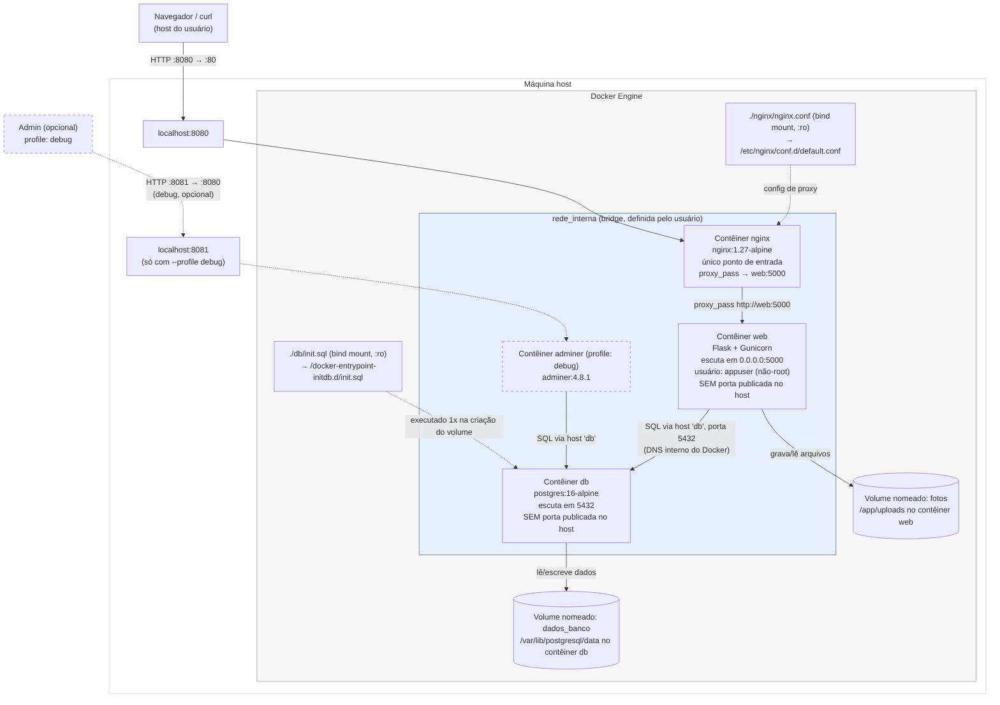

# A2 — Diagrama de arquitetura

> Inclui o desafio bônus de proxy reverso ([`BONUS.md`](BONUS.md)): `nginx` é hoje o único
> serviço com porta publicada no host; `web` só é alcançável de dentro da `rede_interna`.

## Visão geral

## Dentro x fora da rede interna

| Elemento | Posição |
|---|---|
| Navegador / `curl` do usuário | **Fora** de qualquer rede Docker — acessa só a porta publicada `8080` no host. |
| Contêiner `nginx` | **Dentro** de `rede_interna`; é hoje o único ponto de entrada do ambiente (porta `8080:80` publicada). |
| Contêiner `web` | **Dentro** de `rede_interna`; **sem** porta publicada no host desde o desafio bônus do proxy reverso — só é alcançável pelo `nginx` (ou por outro contêiner na mesma rede). |
| Contêiner `db` | **Dentro** de `rede_interna`; nenhuma porta publicada no host — só é alcançável por quem está na mesma rede Docker (`web` e, quando ativo, `adminer`). |
| Contêiner `adminer` (profile `debug`) | **Dentro** de `rede_interna`; porta `8081:8080` publicada, mas o serviço só existe quando subido com `docker compose --profile debug up -d`. |
| Volume `dados_banco` | Não pertence à rede; é um recurso de armazenamento do Docker, montado diretamente no contêiner `db` em `/var/lib/postgresql/data`. |
| Volume `fotos` | Mesma lógica, montado no contêiner `web` em `/app/uploads`. |
| `db/init.sql` | Bind mount somente leitura (`:ro`) do arquivo local `./db/init.sql` para `/docker-entrypoint-initdb.d/init.sql` dentro do contêiner `db`; o entrypoint oficial do Postgres executa qualquer script encontrado nesse diretório na **primeira** inicialização do volume de dados. |
| `nginx/nginx.conf` | Bind mount somente leitura (`:ro`) do arquivo local `./nginx/nginx.conf` para `/etc/nginx/conf.d/default.conf` dentro do contêiner `nginx`. |

## Portas

| Porta no host | Porta no contêiner | Serviço | Publicada? |
|---|---|---|---|
| `8080` | `80` | nginx | Sim — único ponto de entrada de fora do Docker. |
| — | `5000` | web | Não — desde o proxy reverso, só alcançável via `nginx` dentro da rede. |
| — | `5432` | db | Não — RNF03/arquitetura exigem que o banco fique isolado na rede interna. |
| `8081` | `8080` | adminer | Sim, mas só quando o serviço é subido com `--profile debug` (ver [`BONUS.md`](BONUS.md)). |

## Caminhos de montagem

| Volume/mount | Tipo | Caminho no contêiner | Propósito |
|---|---|---|---|
| `dados_banco` | volume nomeado | `/var/lib/postgresql/data` (contêiner `db`) | Diretório de dados do PostgreSQL. |
| `fotos` | volume nomeado | `/app/uploads` (contêiner `web`) | Fotos enviadas via `POST /itens`. |
| `./db/init.sql` | bind mount (`:ro`) | `/docker-entrypoint-initdb.d/init.sql` (contêiner `db`) | Script de criação da tabela `itens` + seed, executado uma única vez. |
| `./nginx/nginx.conf` | bind mount (`:ro`) | `/etc/nginx/conf.d/default.conf` (contêiner `nginx`) | Configuração do proxy reverso (desafio bônus). |

Evidência real dos dois volumes (`docker volume inspect`) em
[`evidencias/16-volume-inspect-dados_banco.txt`](evidencias/16-volume-inspect-dados_banco.txt) e
[`evidencias/17-volume-inspect-fotos.txt`](evidencias/17-volume-inspect-fotos.txt).
